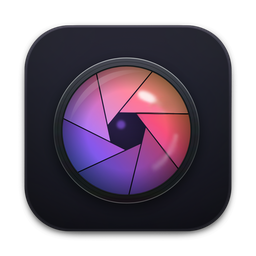
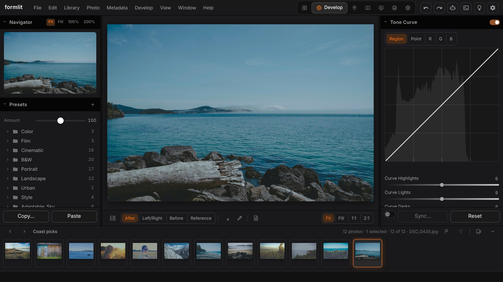
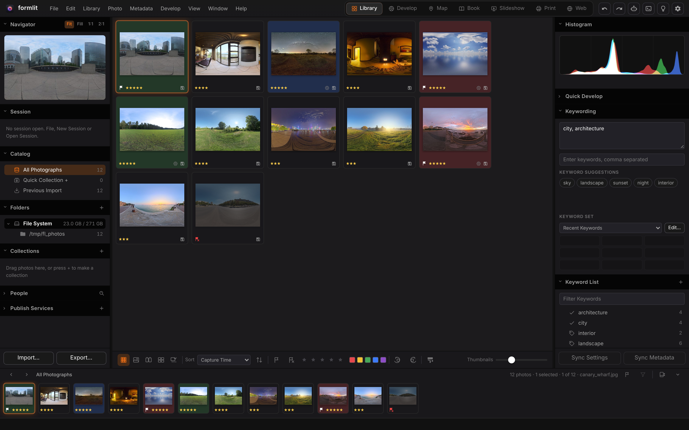
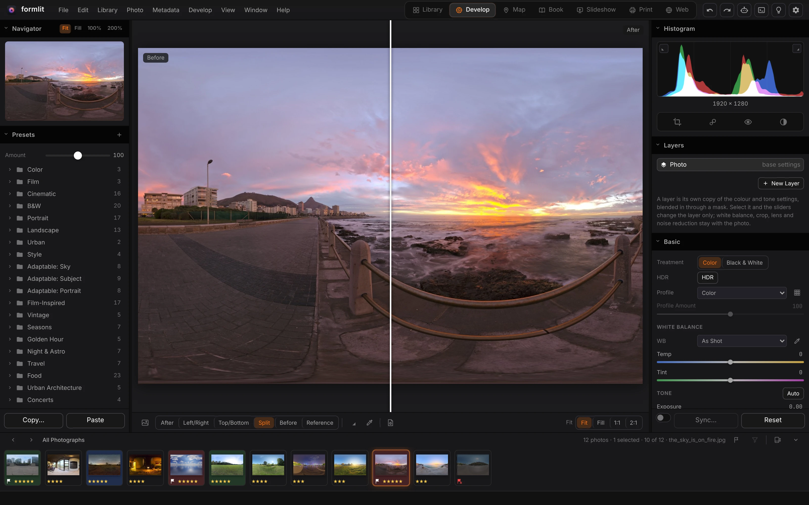
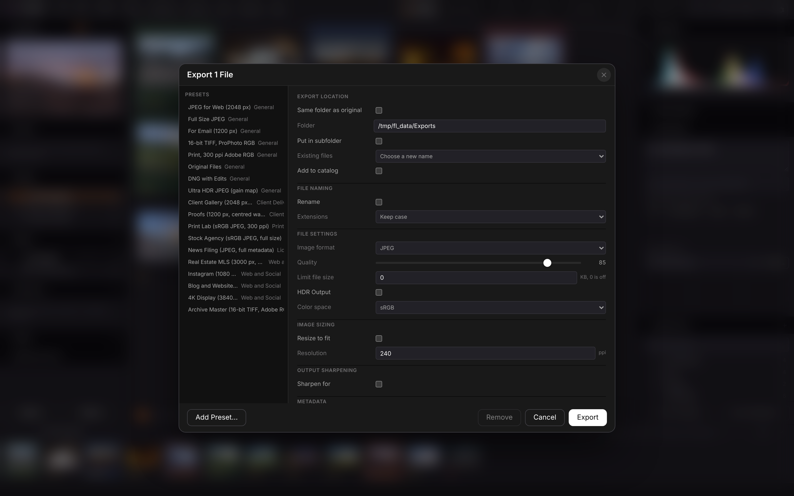

<p align="center">
  
</p>

<h1 align="center">FormLit</h1>

<p align="center">
  <b>Photography; a photo library and raw developer for the web and the desktop.</b><br>
  Catalog, cull, develop, map, print and publish,<br>
  non-destructively, on your own machine. No account, and agents can work in it over MCP.
</p>

<p align="center">
  
  
  
  
  
  
</p>

<p align="center">
  <a href="https://formlit.formai.studio/"><b>Download FormLit on formai.studio</b></a> ·
  <a href="#run-it-from-source">Run it from source</a> ·
  <a href="#the-form-family">All Form apps</a>
</p>

<br>

<p align="center">
  
  <br>
  <sub>The Develop module on a coastal photo, with presets, the tone curve and the filmstrip.</sub>
</p>

<p align="center">
  <a href="#features">Features</a> ·
  <a href="#everything-in-the-box">In the box</a> ·
  <a href="#built-for-agents">Agents</a> ·
  <a href="#under-the-hood">Under the hood</a> ·
  <a href="#download">Download</a> ·
  <a href="#run-it-from-source">Run from source</a> ·
  <a href="#the-form-family">Form family</a>
</p>

<br>

<table>
  <tr>
    <td width="25%" valign="top"><h3>Non-destructive</h3>One catalog with undo for every change, and edits kept in settings and sidecars, never in your originals.</td>
    <td width="25%" valign="top"><h3>Raw to print</h3>Library, Develop, Map, Book, Slideshow, Print and Web modules take a shoot from import to delivery.</td>
    <td width="25%" valign="top"><h3>Local AI</h3>Masks, denoise, culling and search by description run on your machine with ONNX Runtime and pinned models.</td>
    <td width="25%" valign="top"><h3>Agent-ready</h3>The same 280 commands from the window, the terminal and an MCP server for Claude Code, Codex and Cursor.</td>
  </tr>
</table>

<br>

## Features

<table>
  <tr>
    <td width="50%" valign="top"><br><sub>The Library grid with ratings, flags, colour labels and keywords.</sub><h3>A catalog that keeps up</h3>Rate, flag, label and keyword photos, then find them again with collections, filters and search by description.</td>
    <td width="50%" valign="top"><br><sub>Develop with a split Before and After view.</sub><h3>One pipeline for screen and export</h3>The engine renders the preview, 1:1 regions and exports from the same pipeline, so what you see is what you save.</td>
  </tr>
  <tr>
    <td width="50%" valign="top"><br><sub>The Export dialog and its built-in presets.</sub><h3>Export for the job</h3>Presets for web, email, print, client galleries, stock and archive, with sizing, sharpening, colour space and metadata choices.</td>
    <td width="50%" valign="top"><h3>Proof, publish and tether</h3>Export a proofing gallery a client opens in any browser, publish to folders, FTP, WebDAV, Nextcloud or S3, and tether a camera with gphoto2 or digiCamControl.</td>
  </tr>
</table>

<sub>Screenshot content: CC0 photos from Poly Haven.</sub>

## Everything in the box

<table>
  <tr>
    <td width="33%" valign="top"><h4>7 modules</h4>Library · Develop · Map · Book · Slideshow · Print · Web</td>
    <td width="33%" valign="top"><h4>978 presets in 103 groups</h4>Color · Film · Cinematic · B&amp;W · Portrait · Landscape · Golden Hour · Night &amp; Astro · Travel · Food</td>
    <td width="33%" valign="top"><h4>Formats</h4>Opens: raw through LibRaw, JPEG, TIFF, PNG, PSD, HEIC, AVIF, WebP, JPEG XL, video · Saves: JPEG, PNG, TIFF, PSD, JPEG XL, WebP, AVIF, HEIC, DNG</td>
  </tr>
  <tr>
    <td width="33%" valign="top"><h4>26 languages</h4>English by default, with the engine's messages and preset names translated too</td>
    <td width="33%" valign="top"><h4>Masks and retouching</h4>Brush · Gradients · Range masks · AI subject and sky · Heal · Clone · Remove</td>
    <td width="33%" valign="top"><h4>Merges</h4>HDR · Panorama · Focus stack · Astro stack · Flash and window blend</td>
  </tr>
</table>

## Built for agents

The window, the terminal and the MCP server call the same registry of 280 engine commands, and the MCP server exposes 80 curated tools over it.

```sh
./formlit cli list                                  # every engine command
./formlit cli library.import 'paths=["/path/to/photos"]' mode=add   # import a folder
./formlit cli photo.rate ids=[1,2] rating=5         # rate photos
./formlit mcp                                       # MCP server on stdio for Claude Code, Codex and Cursor
```

`.mcp.json`, `.codex/config.toml` and `.cursor/mcp.json` are already wired in this repo. See [`AGENTS.md`](AGENTS.md).

## Under the hood

- **Engine:** Python 3.12 and FastAPI, with a SQLite catalog in WAL mode and a numba develop kernel.
- **Interface:** vanilla TypeScript and Vite, no UI framework, with the Form family's Studio Dark design.
- **Desktop:** a Tauri 2 shell around the engine as a sidecar; it picks a free port when 8390 is taken.
- **Local models:** ONNX Runtime, downloaded on first use and pinned to a SHA-256.
- **Zero flash:** the shell mounts once and every list is patched by key, not re-rendered.

## Download

**Get the app:** download FormLit from [formai.studio](https://formlit.formai.studio/). That is the easiest way to install it.

**Releases:** builds are published in [`nodemode-dev/formcompiler`](https://github.com/nodemode-dev/formcompiler/releases?q=formlit-v&expanded=true). No FormLit release has been published there yet.

**Keep it updated:** [FormPortal](https://github.com/nodemode-dev/formportal) installs, updates and rolls back every Form app from the same signed catalogue.

| Platform | Builds |
|---|---|
| macOS | Apple silicon (`macos-arm64`) and Intel (`macos-x64`) |
| Linux | `linux-x64` |
| Windows | `windows-x64` |

All FormLit builds are compiled and released from [`nodemode-dev/formcompiler`](https://github.com/nodemode-dev/formcompiler/releases), not from this repo. This repo holds the source.

## Run it from source

Prefer it in your browser, or want to contribute? Run the web UI straight from this repo.

**Requires:** Node 20.19 or newer, Python 3.12 or newer, git. `ffmpeg` on the PATH for video export and slideshows.

```sh
git clone git@github.com:nodemode-dev/formlit.git
cd formlit
./formlit install     # engine (add --lite to skip the AI extra) and frontend
./formlit boot        # web UI at http://localhost:5390
```

`./formlit desktop dev` opens the desktop window instead (needs Rust and the Tauri 2 system packages), and `./formlit help` lists every command.

On Windows use `formlit.bat install` and `formlit.bat boot`. The engine listens on http://127.0.0.1:8390 (API under `/api`, MCP at `/mcp`); `FORMLIT_DATA_DIR` moves the data root (default `~/Formlit`).

> [!IMPORTANT]
> **Status:** pre-release. The desktop bundle has not been built from a release branch yet, and tethering, printing and Windows terminals are untested on real hardware. See [`docs/PARITY.md`](docs/PARITY.md).

**Contributing:** branch from `main`, keep changes to source here, and leave packaging and releases to FormCompiler. See [`.docs/BRANCHING.md`](.docs/BRANCHING.md) and [`AGENTS.md`](AGENTS.md).

## Repository

| Path | What it is |
|---|---|
| `backend/` | FastAPI engine: catalog, develop pipeline, local AI, output |
| `frontend/` | Vite app in vanilla TypeScript |
| `src-tauri/` | Tauri 2 desktop shell |

Docs: [`.docs/wiki`](.docs/wiki) · Agents: [`CLAUDE.md`](CLAUDE.md), [`AGENTS.md`](AGENTS.md) · Contributing: [`.docs/BRANCHING.md`](.docs/BRANCHING.md)

## The Form family

FormLit is one of the **Form apps**: native creative tools that install, update and roll back through FormPortal and can all be driven by agents.

| | App | What it's for | Download | Code |
|:-:|---|---|---|---|
|  | **form.md** | Documents, databases and realtime editing together | [formai.studio](https://formmd.formai.studio/) | [GitHub](https://github.com/nodemode-dev/form.md) |
|  | **FormAT** | Chat and agent workspace on your key | [formai.studio](https://format.formai.studio/) | [GitHub](https://github.com/nodemode-dev/format) |
|  | **FormCAD** | Drafting, parametric parts and NURBS surfaces | | [GitHub](https://github.com/nodemode-dev/formCAD) |
|  | **FormCel** | Spreadsheets agents can read and edit | [formai.studio](https://formcel.formai.studio/) | [GitHub](https://github.com/nodemode-dev/formcel) |
|  | **FormCraft** | Generate images, video, audio, 3D and worlds | | [GitHub](https://github.com/nodemode-dev/formcraft) |
|  | **FormCut** | Multi-track video editing with no upload | [formai.studio](https://formcut.formai.studio/) | [GitHub](https://github.com/nodemode-dev/formcut) |
|  | **FormDAM** | Photo library and asset manager | [formai.studio](https://formdam.formai.studio/) | [GitHub](https://github.com/nodemode-dev/formDAM) |
|  | **FormDeck** | Presentations and pitch decks | [formai.studio](https://formdeck.formai.studio/) | [GitHub](https://github.com/nodemode-dev/formdeck) |
|  | **FormDesign** | Page layout for print and the web | [formai.studio](https://formdesign.formai.studio/) | [GitHub](https://github.com/nodemode-dev/formdesign) |
|  | **FormEncoder** | Media encoding queue with presets | [formai.studio](https://formencoder.formai.studio/) | [GitHub](https://github.com/nodemode-dev/formencoder) |
|  | **FormFabric** | Sewing patterns draped with cloth simulation | | [GitHub](https://github.com/nodemode-dev/formfabric) |
|  | **FormLit** | Photo library and raw development | [formai.studio](https://formlit.formai.studio/) | [GitHub](https://github.com/nodemode-dev/formlit) |
|  | **FormMorpheus** | Frame-by-frame and performed animation | | [GitHub](https://github.com/nodemode-dev/formmorpheus) |
|  | **FormNET** | See what your computer sends online | | [GitHub](https://github.com/nodemode-dev/formNET) |
|  | **FormPath** | Vector illustration with artboards and type | [formai.studio](https://formpath.formai.studio/) | [GitHub](https://github.com/nodemode-dev/formpath) |
|  | **FormPDF** | Edit, redact, sign and fill PDFs | [formai.studio](https://formpdf.formai.studio/) | [GitHub](https://github.com/nodemode-dev/formpdf) |
|  | **FormPromo** | Promo films from your own media | [formai.studio](https://formpromo.formai.studio/) | [GitHub](https://github.com/nodemode-dev/formpromo) |
|  | **FormRef** | Reference boards for creative work | [formai.studio](https://formref.formai.studio/) | [GitHub](https://github.com/nodemode-dev/formref) |
|  | **FormRig** | Rig, skin and retarget any mesh | | [GitHub](https://github.com/nodemode-dev/formrig) |
|  | **FormSculpt** | 3D sculpting, remeshing and painting | [formai.studio](https://formsculpt.formai.studio/) | [GitHub](https://github.com/nodemode-dev/formsculpt) |
|  | **FormSurface** | Texture painting with PBR export | [formai.studio](https://formsurface.formai.studio/) | [GitHub](https://github.com/nodemode-dev/formsurface) |
|  | **FormTools** | Viewers, batch tools and file utilities | | [GitHub](https://github.com/nodemode-dev/formtools) |
|  | **FormTxt** | Word processing with .docx round trips | [formai.studio](https://formtxt.formai.studio/) | [GitHub](https://github.com/nodemode-dev/formtxt) |
|  | **FormVFX** | Motion graphics and VFX compositing | [formai.studio](https://formvfx.formai.studio/) | [GitHub](https://github.com/nodemode-dev/formvfx) |
|  | **FormVis** | Layered image editing with local AI | [formai.studio](https://formvis.formai.studio/) | [GitHub](https://github.com/nodemode-dev/formvis) |
|  | **FormWav** | Multitrack audio editing and mixing | [formai.studio](https://formwav.formai.studio/) | [GitHub](https://github.com/nodemode-dev/formwav) |
|  | **FormWeb** | Visual website building with a CMS | [formai.studio](https://formweb.formai.studio/) | [GitHub](https://github.com/nodemode-dev/formweb) |
|  | **FormPortal** | Install, update and roll back Form apps | [formai.studio](https://formportal.formai.studio/) | [GitHub](https://github.com/nodemode-dev/formportal) |
|  | **FormTray** | One dock icon for every app | [formai.studio](https://formtray.formai.studio/) | [GitHub](https://github.com/nodemode-dev/formtray) |
|  | **FormMCP** | One MCP connection to the family | [formai.studio](https://formmcp.formai.studio/) | [GitHub](https://github.com/nodemode-dev/formMCP) |
|  | **FormSkills** | Every app's agent skills in one place | [formai.studio](https://formskill.formai.studio/) | [GitHub](https://github.com/nodemode-dev/formskills) |
|  | **FormBench** | Parity, testing and rankings for the family | [formai.studio](https://formranker.formai.studio/) | [GitHub](https://github.com/nodemode-dev/formbench) |
|  | **FormSlot** | Codebase memory for coding agents | | [GitHub](https://github.com/nodemode-dev/formslot) |
|  | **SubForm** | Workbench for parallel Claude Code agents | | [GitHub](https://github.com/nodemode-dev/subform) |
|  | **FormCompiler** | Builds, signs and releases every app | [formai.studio](https://formcompiler.formai.studio/) | [GitHub](https://github.com/nodemode-dev/formcompiler) |
|  | **FormPipe** | Release pipeline and update feeds | | [GitHub](https://github.com/nodemode-dev/formpipe) |

<br>

---

## Maintainers

| Maintainer | Role |
|---|---|
| [@nodemode-ai](https://github.com/nodemode-ai) | Owner |
| [@gbarnai](https://github.com/gbarnai) | Co-owner |

Code owners are set in [`.github/CODEOWNERS`](.github/CODEOWNERS).

## License

FormLit is licensed under the Apache License 2.0 ([`LICENSE`](LICENSE), SPDX `Apache-2.0`). Copyright 2026 NodeAgentc, Inc. Third-party notices: [`NOTICE.md`](NOTICE.md).

This product includes DNG technology under license by Adobe Systems Incorporated.

<sub>Adobe, Camera Raw, Lightroom and Photoshop are trademarks of Adobe. FormLit is an independent project and is not affiliated with or endorsed by Adobe; the names describe file formats and compatibility only.</sub>
