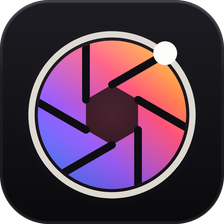

<p align="center"></p>
<h1 align="center">formlit</h1>
<p align="center"><b>A photo library and raw developer for the web and the desktop, in the form family's Studio Dark design.</b></p>
<p align="center">


</p>

## What it is

formlit is the form family's photo library and raw developer: a catalog of your photos, a non-destructive raw developer, and the Library, Develop, Map, Book, Slideshow, Print and Web modules, local-first, with the same agent harness as formvis so Claude Code, Codex and Cursor can cull, develop and export through tools. It runs in a browser against its local engine, or as a desktop app for macOS, Windows and Linux.

**Stack.** Vanilla TypeScript 7 and Vite 8 · Python 3.12 and FastAPI · Tauri 2. Code size, in lines: about 16,300 of TypeScript, 2,300 of CSS, 25,900 of Python, 131 of Rust (product code, tests excluded; `./formlit counts` prints this, and `./formlit counts --check` verifies it).

**Features.** Every module and its status, traced in code and graded by independent audits: see [docs/PARITY.md](docs/PARITY.md).

## Highlights

- **Languages.** The whole window in 26 languages, English by default (Preferences, Language): English, Spanish, Mexican Spanish, Brazilian Portuguese, French, Canadian French, German, Italian, Dutch, Danish, Finnish, Norwegian Bokmål, Swedish, Russian, Polish, Czech, Hungarian, Ukrainian, Turkish, Simplified and Traditional Chinese, Japanese, Korean, Indonesian, Thai and Vietnamese, with standard photography terms in each, the engine's messages and preset names included, and dates in the chosen locale.
- **Catalog.** SQLite in WAL mode with one revision counter and undo for every change, people and agents alike. Import adds in place, copies, moves or copies as DNG, with rename and folder templates, develop and metadata presets, keywords, a second copy, duplicate detection and eject. Folders show their volumes, synchronize (new, missing, changed on disk, metadata), relocate and find missing files. Intelligent previews keep offline photos editable. Export as Catalog and Import from Another Catalog move work between catalogs.
- **Formats.** Raw from over a thousand cameras through LibRaw, decoded to linear Rec.2020 with the camera's white balance; JPEG, TIFF (8, 16 and float, ICC aware), PNG, PSD (8 and 16-bit), HEIC, AVIF, WebP and JPEG XL; video with playback, trim and Capture Frame.
- **Library.** Grid, Loupe with a Navigator, Compare with linked zoom, Survey, a Cull view (K: bursts reviewed together with the best frame starred, sharpness, exposure and eyes-open scores, faces at full size, one key per decision, Shift+P to keep one frame and reject the rest of its burst), and a second window (Grid, Loupe normal, live or locked, Compare, Survey, Slideshow). Ratings, flags and colour labels with auto advance; collections, sets, intelligent collections with nested rules; hierarchical keywords with synonyms, suggestions, keyword sets and the Painter; metadata views and presets; code replacements (`=23=` becomes a roster line in any field, sets imported from text files) and caption variables such as `{date}` and `{city}`; required fields checked before export; stacks, virtual copies, batch rename and capture time; the filter bar with Text, Attribute and Metadata columns; faces found, clustered and named in People.
- **Develop.** One pipeline rendered by the engine (numba kernel, numpy reference) for the screen, 1:1 regions and exports alike: white balance, Basic with Auto, presence, parametric and point curves with targeted adjustment, colour mixer and Point Color, Skin Tone uniformity for hue, saturation and lightness with a skin picker, colour grading, B&W mix, profiles with a browser (looks and B&W looks as 3D tables with Amount, camera-matching styles per maker, Adobe creative profile .xmp, .cube and .dcp import, DCPs applied in camera space), calibration, sharpening, noise reduction, lens profiles from Lensfun and DNG opcodes, chromatic aberration and defringe, Upright with guides, crop with seven overlays and a Straighten tool, vignette and grain, history, snapshots, a settable Before, copy, paste, sync and auto sync, 978 built-in presets in 103 groups, researched with sources (exposure steps, raw white balance by light source, B&W filters, sharpening and noise by sensor, product, food, real estate, underwater, skin-tone families, portrait, headshot, wedding with signature, indoor and night variants, event, fashion, family, newborn, cinematic, film-inspired, vintage, black and white, fine art, toning, documentary within news ethics, street, seasons, weather, landscape, golden hour, night and astro, aerial, macro, wildlife, pets, sports, automotive, travel, food, product, real estate, architecture, interiors, concerts, lifestyle, social, moody, futuristic, illustration, HDR, underwater, noise by ISO, curves, detail, effects, colour fixes, utility and adaptive sky, subject, portrait and landscape masks), each with a description, with amount, hover preview and import of .xmp and .lrtemplate.
- **Masks and retouching.** Brush, linear and radial gradients, colour, luminance, edge and depth ranges (click the photo to pick a distance), combined with add, subtract and intersect; AI masks for subject, sky, background, objects, people (each person on their own), people parts and landscape parts, recomputed for every photo a mask reaches by sync, paste, preset or virtual copy; Refine Edge, Shift Edge and Feather on every AI mask, edge points to drag an AI mask's outline where the model got it wrong (the model's fine edge stays wherever the outline is untouched), a Refine Edge Brush for hair and fur, and Edge Snap on the brush (its soft edge stops at the nearest strong edge); adjustment layers (up to eight per photo), each a full copy of the colour and tone settings with every slider, the curve, mixer and grading, blended through any mask at an opacity; 17 local sliders, a local tint, local Point Color and a local point curve with R, G and B. Heal, clone and generative Remove (LaMa) with variations ranked plainest first, Refresh for new ones, Detect Objects and Shadows and Reflections, Keep Lines (tile joints, sills and railings that cross the object carry on through the fill), Remove People, Find Dust and Visualize Spots; red eye and pet eye.
- **AI and merges.** Denoise (a learned real-world denoiser, SCUNet), Super Resolution and Raw Details; HDR, panorama and HDR panorama merges with deghosting, boundary warp, fill edges and Create Stack; focus stacking with alignment for focus breathing and a seamless pyramid blend; astro stacking that aligns night-sky frames on their stars (wide-lens distortion included), removes hot pixels, rejects satellites and planes, and keeps the landscape sharp; flash and window blending for interiors (flambient colour from the flash frame, windows pulled from the darker frames in darken mode); Lens Blur from a depth map with five bokeh shapes; assisted culling by sharpness, exposure, eyes open and face focus; search by description ("two people on a beach at sunset", no keywords needed) and Find Similar Photos with SigLIP; batch skin retouching (a skin mask and healed blemishes per photo, freckles and moles kept, all editable). Every model runs locally on ONNX Runtime, downloads on first use, and is pinned to a SHA-256.
- **HDR.** An HDR editing mode with headroom, Visualize HDR, an SDR rendition and an HDR histogram, previewed as PQ on HDR displays; Ultra HDR JPEG with a gain map, HDR AVIF, JPEG XL and float TIFF on export.
- **Tethering.** gphoto2 on macOS and Linux, digiCamControl on Windows: Live View, camera settings, a develop setting applied as photos arrive (including Same as Previous), and auto import from a watched folder.
- **Sessions.** A session is a folder with Capture, Selects, Output and Trash: tethered shots land in Capture, exports default to Output, Move to Selects (Alt+Shift+J), Move to Session Trash and Move Back to Capture move files with their settings, and every photo's settings, rating, flag, label and captions are kept as small files inside the folder, so the session opens with its edits on any machine (File, Open Session). The Session panel at the top of the Library lists its folders.
- **Client proofing.** File, Export Proofing Gallery makes a folder the client opens in any browser, with no account and no server: they pick, reject, rate and comment (kept in their browser as they go), then save a small selections file. File, Import Client Selections turns it into flags, ratings, comments in the Comments panel and a collection of the picks.
- **Output.** Export to JPEG, PNG, TIFF, PSD (layered with Open as Layers), JPEG XL, WebP, AVIF, HEIC or DNG (the original raw for DNG sources), with sizing, output sharpening, custom ICC profiles, metadata choices (private map locations stay private), watermarks, naming, presets and post-processing. Print with grid, picture package and custom layouts, printer profiles, driver Page Setup and Printer Settings. Books with spreads, wrap covers with a spine, custom pages and print-ready PDFs for Blurb, Lulu, Amazon KDP and IngramSpark (each printer's bleed, binding side and page rules, with notes on anything it would reject). Slideshows with music (up to ten tracks), audio balance, fit to music and video clips, exported as H.264. Web galleries with FTP upload. Publish services for folders, FTP, WebDAV and Nextcloud (with comments), S3-compatible storage and Python plug-ins (File > Plug-in Manager). Edit In any application.
- **Map.** OpenStreetMap tiles with Hybrid, Satellite, Light and Dark styles, search, drag to geotag, GPX track logs, saved and private locations, reverse geocoding.
- **XMP.** Sidecars and embedded XMP carry the full Camera Raw settings (curves, profiles, lens profiles, masks, spots, red eye), written automatically and checked for changes made by other applications.
- **Agents.** Add the formlit plugin from the Form marketplace, open formlit and ask Claude; formlit asks once in its own window whether to allow it (Preferences, AI agents). The MCP server gives Claude, Codex and Cursor 80 curated tools over the engine's 280 commands (and `run_command` for the rest), and 17 workflow prompts built from research into how professional photographers work (ingest and cull, wedding and event, portrait, landscape, news and sports with the AP and NPPA limits, real estate, product, client delivery, concert, stock, night sky, wildlife, social, catalog maintenance). `setup_shoot` starts a job from one of twelve shoot recipes in one call: the shoot's collection set with stage intelligent collections, then an import with the recipe's naming, metadata and keywords. `list_templates` and `apply_template` reach the built-in filename, folder, metadata (including Creative Commons licences), keyword set, intelligent collection and export templates, and `noise_by_iso` sets noise reduction per photo by its ISO. `analyze_photo` measures a photo or a whole set (tonal zones, clipping, colour cast, colour bands) and suggests values; `match_look` copies a reference photo's look in one call; `get_preview` and `analyze_photo` try values or any preset without saving; every develop write can return its measurement (`report`), so a typical look takes four or five calls; `save_preset` keeps a look; AI masks reach people and landscape parts. The `formlit-driving` skill teaches the workflow and carries an editing guide built from Adobe's documentation and photography publications, with sources, plus the full preset list. The `formlit-harness` skill pack guides agents that develop formlit's own code.
- **Terminal and Claude Code inside formlit.** A terminal dock (Window, Show Terminal, Ctrl or Cmd+J) runs real login shells, and its Claude Code button (Ctrl or Cmd+Shift+J) starts your own Claude Code sign-in in a dock tab, already connected to formlit's MCP tools, so Claude works on the open catalog while you watch, with no outside-agent prompt. The Ask line under the dock sends a request, with the selected photo ids, to that session.
- **Workspace.** Every panel can be shown or hidden (right-click a panel header), dragged to a new place in its column, and opened alone with Solo Mode per side. Side widths, hidden areas, panel order and Solo Mode are kept between sessions. The filmstrip's height drags, it collapses to its header (double-click it or Alt+F6) and docks above or below the photos, and the module picker's modules can be hidden (right-click it). Window, Workspace switches between Default, Culling: Big Grid, Editing: Wide Panels, Working with Claude (the dock's Chat open) and Photo Only, and saves your own workspaces; Reset Panels brings every panel back in its original order.
- **Zero-flash interface.** The shell mounts once and every list is patched by key; each interface change is verified in a browser throttled to 4x CPU and a slow network.

## Quick Start

Requirements: Node 20.19 or newer (22 recommended), Python 3.12 or newer, git. ffmpeg on the PATH for video export, slideshows and graded video. The desktop build also needs Rust stable and the Tauri 2 system packages for your OS.

### macOS and Linux

```bash
git clone https://github.com/nodemode-ai/formlit.git
cd formlit
./formlit install
./formlit boot
```

### Windows

```bat
git clone https://github.com/nodemode-ai/formlit.git
cd formlit
formlit.bat install
formlit.bat boot
```

`./formlit install` installs the engine with ONNX Runtime and the frontend; `--lite` skips the AI extra. For the desktop app, `./build_app` does everything from a fresh clone on macOS or Linux: it checks the tools (installing Rust with rustup when missing), installs the engine and the frontend, builds the window, freezes the engine into the sidecar, bundles the app, and on macOS copies it to Applications (`--no-install` keeps it in place, `--open` opens it, `--lite` skips the AI extra, `--clean` rebuilds from nothing); every step is logged to `build_app.log`. On Windows, `build_app.bat` runs the same steps (`--lite`, `--open`). `./formlit desktop build` runs the same script, and `./formlit desktop dev` runs the app from source. `./formlit help` lists every command, and `./formlit doctor` checks the toolchain and ports.

| Service | URL | Notes |
| --- | --- | --- |
| Frontend (dev) | http://localhost:5390 | Vite, bound to localhost only, strict port |
| Engine | http://127.0.0.1:8390 | FastAPI; API under `/api`, MCP at `/mcp`; serves the built app in `./formlit serve` |
| Preview | http://localhost:5391 | `vite preview` of the production build |
| Desktop engine | http://127.0.0.1:8390 | the shell asks the sidecar for 8390 so the plugin can reach `/mcp`; when 8390 is taken the sidecar picks a free port and the shell reads it from the startup line |

## Configuration

The engine reads `backend/.env`, which is never committed; `backend/.env.example` is the template.

| Variable | Purpose |
| --- | --- |
| `FORMLIT_HOST`, `FORMLIT_PORT` | Engine bind address and port; port `0` picks a free one, and the desktop sidecar also falls back to a free port when the one asked for (8390) is already in use |
| `FORMLIT_DATA_DIR` | Data root (default `~/Formlit`): catalog, presets, profiles, plug-ins, models, exports |
| `FORMLIT_LIBRARY_DIR` | The folder browser's starting folder, and where photos uploaded from a browser are saved (default `~/Pictures/formlit`) |
| `FORMLIT_CATALOG` | Catalog file to open instead of the last one used |
| `FORMLIT_CORS_ORIGINS` | Allowed browser origins for the dev frontend |
| `FORMLIT_DIST` | Built frontend folder the engine serves |
| `FORMLIT_WORKERS` | Preview and export worker threads |
| `FORMLIT_MODELS_DIR` | Where local AI models are kept |
| `FORMLIT_GPHOTO2`, `FORMLIT_DIGICAM` | Paths to the tethering programs when they are not on the PATH |
| `FORMLIT_AGENT_DIR` | The folder Claude Code starts in from the terminal dock (default `~/Formlit/Agent`) |
| `FORMLIT_CLAUDE_BIN` | Path to the `claude` program when it is not found on the PATH or in the usual install folders |
| `FORMLIT_MCP_ALLOW_DELETE` | `1` lets agents delete photos and folders and open or create catalogs, which otherwise only a person can do in the window |

## Architecture

```text
formlit/
├── build_app                       one-shot desktop build: tools, install, window, sidecar, bundle, install to Applications
├── build_app.bat                   the same on Windows: tools, install, window, sidecar, installers
├── formlit, formlit.bat            root dispatcher: install, boot, build, serve, desktop, claude, mcp, agents, cli, doctor, counts
├── formlit_oc_install(.bat)        one-command install
├── setup/                          one script per task, each with a .bat twin; lib.sh holds shared helpers
├── shared/controls.json            the develop control table read by the engine, the interface and the agents
├── backend/                        FastAPI engine
│   ├── app/engine/                 catalog, command registry, events, tasks, queries, cmd_library, cmd_develop, cmd_ai, cmd_output
│   ├── app/develop/                the pipeline: geometry, planes, finish, numba kernel, masks, retouch, profiles, lens blur
│   ├── app/ai/                     local models: segmentation, depth, faces, cull, merge, enhance, upright
│   ├── app/output/                 export, encode, print and book pages, slideshow, web, publish and its plug-ins
│   ├── app/services/               decode, import, previews, metadata and XMP, tether, watch, catalog import and export
│   ├── app/routers/                REST, events, photos, files, output and the MCP endpoint
│   └── formlit_engine.py           PyInstaller entry for the desktop sidecar
├── frontend/                       Vite app, vanilla TypeScript
│   ├── src/modules/                library, develop, output (map, book, slideshow, print, web), shared commands and dialogs
│   ├── src/state/                  catalog, library selection and develop session state
│   ├── src/ui/                     shell, grid, viewer, panels, menus, dialogs, icons, themes, DOM helpers
│   └── src/styles/                 formvis Studio Dark tokens and sheets, plus formlit's lit- sheets
├── src-tauri/                      Tauri 2 shell: splash, sidecar spawn, port handshake, updater
├── docs/                           PARITY.md and the publish plug-in example
├── .docs/                          BRANCHING.md and the wiki source
├── .github/workflows/              ci, wiki publish, desktop release matrix
├── .claude/skills/                 formlit-harness (developing formlit) and formlit-driving (using it)
└── .agents/, .codex/, .cursor/     the same MCP server and driving skill for Codex and Cursor
```

## Agents

**Use formlit from Claude.** Add the formlit plugin from the Form marketplace: in the Claude app open Customize, Plugins, or run `/plugin` in Claude Code. Open formlit, then ask Claude to cull, develop or export your photos. The first time, formlit asks in its own window whether to let Claude in; Allow, Not now and Block are all fine, and you can change the answer later in Preferences, AI agents. The plugin works in Cowork and in Claude Code, which run on your computer; Claude chat on the web or the phone cannot reach it.

**Claude Code inside formlit.** Install Claude Code (https://claude.com/claude-code) and sign in once by running `claude` in any terminal. Then press the sparkle in formlit's title bar, or Ctrl or Cmd+Shift+J: a Claude Code tab opens in the terminal dock, started in `~/Formlit/Agent` (Preferences, AI agents, Starts in folder changes it, as does `FORMLIT_AGENT_DIR`; Start with message gives every new session a first message) with formlit's MCP server attached over HTTP and its tools allowed. Because you started it in the window, it skips the outside-agent prompt; Block in Preferences, AI agents still refuses it. The dock also has a Chat tab (the chat button, or Ctrl or Cmd+Alt+J) for people who would rather not use a terminal: type in the Ask line and Claude answers in a formatted conversation, through `claude -p` with formlit's tools only, its tool calls and the photos it looks at shown as they happen, a live meter of memory used, reply tokens and cost, and Stop and New Chat. The conversation continues across messages and survives reloading the window; Open in Claude Code continues it in a terminal tab, and From Claude Code brings a terminal conversation back into the Chat. Outside agents cannot open, read or type into the dock: `run_command` refuses every `terminal.*`, `claudecode.*` and `chat.*` command. `./formlit claude` (`formlit.bat claude` on Windows) starts the same kind of session in your own terminal over stdio; that one goes through the outside-agent prompt. Claude Code program in Preferences (or `FORMLIT_CLAUDE_BIN`) points at a `claude` that is not on the PATH.

**Developer setup.** `.mcp.json`, `.codex/config.toml` and `.cursor/mcp.json` run `./formlit mcp`, which starts the engine when it is not running. From any other folder, `./formlit agents install` registers formlit with Claude Code, Codex and Cursor for your user account. After changing the tools in `backend/app/routers/mcp.py`, run `./formlit agents sync` so the driving skill's tool reference and its mirror follow.

## Development

Branch model: `main` plus short-lived work branches, see `.docs/BRANCHING.md`. Docs live in `.docs/wiki/` and publish to the GitHub wiki on merge. Contributions follow the dev-rules laws: single-region hand edits, zero DOM flash or re-render, no emoji, no em dash, no icon-library dependencies, `v*.*.*` versions, Conventional Commits. Start at `.claude/skills/formlit-harness/SKILL.md`, and read `frontend/HASHOUT_LOG.md` and `backend/HASHOUT_LOG.md` before editing.

## Status

Release history: `CHANGELOG.md`. What is not verified yet:

- **Desktop app.** The Tauri shell follows formvis's sidecar template; no release has been built yet, so treat desktop bundles as untested until formcompiler's first formlit build (from a `compile_vX.Y.Z` branch) passes.
- **Plugin.** The consent prompt, the `outsideAgents` setting and the pinned sidecar port were exercised against the engine and the Form bridge; the Rust change that asks the sidecar for 8390 in `src-tauri/src/main.rs` has not been compiled or run in a desktop build.
- **Terminal dock and Claude Code.** Shell tabs, the dock and its shortcuts were exercised in Chromium at 4x CPU throttling on Linux, and Claude Code 2.1 was run against the engine's in-app MCP config and through `./formlit claude`. The interactive Claude Code tab was started but its first-run sign-in could not reach Anthropic from the test machine. Windows terminals (pywinpty) and the terminal inside a built desktop app are untested.
- **Build script.** The first macOS run of `./build_app` installed, built the window and froze the engine, then stopped at `E0463 can't find crate for phf_macros`; v0.7.1 no longer strips proc macros and build scripts (`profile.release.build-override`). A full run after that fix has not been done yet.
- **Hardware.** Tethering was exercised against a simulated gphoto2; the digiCamControl adapter on Windows and real cameras are untested. Printing to a real printer and its driver dialogs are untested.
- **Video in the browser.** Playback of H.264 clips depends on the webview; the open-source Chromium used for testing plays WebM but not H.264.
- **Approximations.** Denoise falls back to non-local means and people parts to heuristics when their models are not installed, landscape parts and eye detection are heuristic, Blurb's spine width is estimated from the page count, and DNG export of non-DNG raws writes uncompressed data. Camera-matching styles are formlit's own approximations built on a per-photo fit to the camera's JPEG; the style a raw was shot in is read from Canon, Nikon, Sony, Fujifilm, Panasonic, Olympus and OM System, and Pentax raws (checked against exiftool on 13 files).
- **Profiles.** DCPs were checked with RawTherapee's camera DCPs on matching raws, and Adobe creative profiles (RGB tables and HSV look tables) with profiles built to the published layouts; not yet with Adobe-made files. The look-table layout is read strictly and a file that does not match it is refused with a message.
- **Reflections.** Distraction Removal has People and Dust; reflection removal waits for a learned model (`docs/PARITY.md`, row 46).

## Contributors

- **nodemode-ai** · owner and build

## Licensing

Apache License 2.0. Copyright 2026 nodemode-ai. See `LICENSE`, and `NOTICE.md` for the open-source code, models and data formlit uses and their licenses.

This product includes DNG technology under license by Adobe Systems Incorporated.

## Trademarks

Adobe, Camera Raw, Lightroom and Photoshop are either registered trademarks or trademarks of Adobe in the United States and/or other countries. formlit is not affiliated with or endorsed by Adobe; the names describe file formats and compatibility only.
